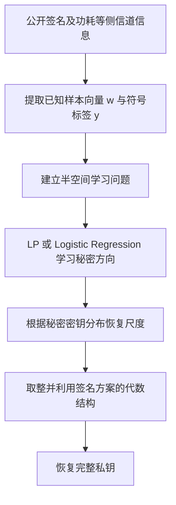

## 0. 论文究竟解决了什么问题？

论文研究一个看似很弱、却可能产生严重后果的信息泄漏：攻击者不知道签名随机数 $x_i$ 的值，只能通过侧信道判断其**正负号**。如果随机数与秘密密钥之间可以写成内积关系，就可以将恢复密钥的问题转化为 **Learning a Halfspace（LH，半空间学习）**。

核心思路如下：

最关键的关系是：

$$
y_i=\mathrm{sign}(x_i)
=\mathrm{sign}(\langle b,w_i\rangle).
$$

其中 $w_i$ 和 $y_i$ 是攻击者获得的数据， $b$ 是未知的秘密向量。注意：**攻击者不能直接计算 $\langle b,w_i\rangle$，因为 $b$ 未知；内积关系只是用来解释符号观测为何约束 $b$。**

这不是对格签名算法的无条件数学破解。攻击成立的前提是签名实现额外泄露了随机数的符号等信息；公开签名本身不等于侧信道泄漏。

**原文定位**：Abstract；Section 1（PDF 第1–6页）。

---

## 1. 符号信息从哪里来：Side-Channel Leakage

格签名执行时使用随机数向量 $x=(x_1,\ldots,x_n)$。在某些软件或硬件实现中，随机数的二进制表示会影响功耗。例如，小幅度整数采用较宽位数的 **二进制补码（two's complement）** 表示时，正负数的汉明重量（Hamming weight，置为1的比特数）可能显著不同。

以8位补码表示 $\pm5$ 为例：

| 整数 | 二进制补码 | 汉明重量 |
|---|---|---:|
| $+5$ | `00000101` | 2 |
| $-5$ | `11111011` | 7 |

如果特定实现的功耗与汉明重量等数据特征相关，攻击者就可能识别随机数符号。论文使用的符号函数定义为：

$$
\mathrm{sign}(x)=
\begin{cases}
+1,&x\ge 0,\\
-1,&x<0.
\end{cases}
$$

**需要区分**：从功耗推断符号是一种依赖设备和实现的侧信道行为；并非“任意正负数都可仅由功耗无误判断”。论文 Section 7 专门通过真实设备实验检验这种泄漏。

**原文定位**：Section 1 *Sign Leakage*；Section 2；Section 4.1（PDF 第1–2、7、15–16页）。

## 2. Definition 1：Learning a Halfspace 的数学模型

### 2.1 样本、标签与秘密向量

设未知秘密向量为 $b\in\mathbb Z^n$，攻击者获得 $m$ 组样本：

$$
(w_i,y_i)\in\mathbb{R}^n\times\lbrace-1,+1\rbrace,
\qquad i=1,\ldots,m.
$$

这个式子的意思是每个样本都由一个 \(n\) 维向量和一个正负标签组成。

在无噪声情况下，标签满足：

$$
y_i=\mathrm{sign}(\langle b,w_i\rangle).
$$

每个标签都告诉我们一个方向限制：若 $y_i=+1$，则 $\langle b,w_i\rangle\ge0$；若 $y_i=-1$，则 $\langle b,w_i\rangle<0$。

在二维空间中，方程

$$
\langle b,w\rangle=0
$$

定义了一条经过原点的分类直线，其中秘密向量 $b$ 是这条直线的**法向量（Normal Vector）**，即垂直于分类边界的向量。

每个 LH 样本的正负标签都能对分类边界施加约束。随着样本数量增加，在分布合适、噪声可控的条件下，可以逐渐确定分类边界，进而推断秘密向量 $b$ 的方向。

但由于 $b$ 与 $cb$（ $c>0$ ），即 $b$ 的倍数，产生相同的符号标签，因此**仅凭 LH 样本无法确定秘密向量的长度**，这就是尺度不变性（Scale Invariance）。

### 2.2 随机分类噪声 $\rho$

论文进一步允许标签独立随机翻转：

$$
y_i=
\begin{cases}
\mathrm{sign}(\langle b,w_i\rangle),&\text{概率 }1-\rho,\\
-\mathrm{sign}(\langle b,w_i\rangle),&\text{概率 }\rho,
\end{cases}
\quad 0\le\rho<\frac12.
$$

$\rho=0$ 表示无噪声 LH； $\rho>0$ 表示含噪 LH。该模型是**随机标签翻转模型**，现实中的侧信道误差并不必然严格服从它。

### 2.3 Scale Invariance：为什么符号只能恢复方向？

对任意 $c>0$：

$$
\mathrm{sign}(\langle b,w\rangle)
=\mathrm{sign}(\langle cb,w\rangle).
$$

因此，符号观测无法区分 $b$ 与 $2b$、 $3b$ 等同向向量。LH 的第一目标是学习方向，之后还必须解决**尺度恢复**问题。

**原文定位**：Section 3，Definition 1、Figure 2、*Scale Invariance*（PDF 第8–9页）。

## 3. Theorem 3 与 Algorithm 1：怎样学习秘密方向？

### 3.1 Theorem 3 的核心直觉

假设真实标签是 $+1$，随机翻转率为 $\rho=0.3$，那么该样本的观测标签为 $+1$ 的概率是70%，为 $-1$ 的概率是30%。对这个固定样本，预测真实标签可获得更低的**期望0–1分类损失**。

> 期望 0–1 分类损失（Expected 0–1 Loss） 是指分类器在所有可能样本上的平均分类错误概率。
> 例如： 如果分类器在总体分布下有20%的概率分类错误，那么它的期望 0–1 损失就是0.2。

推广到总体分布，只要满足论文中的随机分类噪声模型与适当的样本分布条件，真实分类规则

$$
f_b(w)=\mathrm{sign}(\langle b,w\rangle)
$$

仍是最优规则；在支持条件保证方向可识别时，最优线性分类向量与 $b$ 仅差一个正比例常数：

$$
u=cb,\qquad c>0.
$$

**边界**：定理讨论的是总体期望损失与方向识别，不直接保证“有限个样本必然得到真实私钥”。

### 3.2 为什么不用0–1 Loss 直接优化？

0–1 Loss 只判断对错：预测正确损失为0，错误损失为1。它无法反映分类错误的程度，而且不连续、非凸，高维精确优化困难。

对于无噪声 LH，可以寻找同时满足全部符号不等式的向量（论文使用 LP，线性规划）；出现相互矛盾的错误标签时，这种**硬约束**可行性问题可能无解。

论文转而使用平滑的凸替代损失 Logistic Loss。**分类间隔（Margin）** 定义为：

$$
z_i=y_i\langle u,w_i\rangle
$$

其中，标签 $y_i$ 只能取 $-1$ 或 $+1$， $u$ 为待学习的分类向量， $w_i$ 为样本向量。

当 $z_i>0$ 时，分类正确；当 $z_i<0$ 时，分类错误；当 $z_i=0$ 时，样本位于分类边界上。

>**举例：理解 LH 样本与符号标签**
假设秘密向量为：
$$b=(2,-1)$$
现在有两个样本向量：
$$w_1=(3,1),\qquad w_2=(1,4)$$
分别计算它们与秘密向量 $b$ 的内积：
**第一个样本：**
$$\langle b,w_1\rangle=2\times3-1\times1=5$$
由于内积为正，因此：
$$y_1=+1$$
**第二个样本：**
$$\langle b,w_2\rangle=2\times1-1\times4=-2$$
由于内积为负，因此：
$$y_2=-1$$
所以，我们得到两个 LH 样本：
$$(w_1,y_1)=((3,1),+1)$$
$$(w_2,y_2)=((1,4),-1)$$
**关键结论：** LH 样本的标签只表示内积的正负号，而不是内积的具体数值。
在实际密码分析中，秘密向量 $b$ 是未知的。攻击者只能获得已知样本向量 $w_i$，以及通过侧信道泄漏得到的符号标签 $y_i$，再利用大量这样的样本逐渐推断秘密向量 $b$ 的方向。

Logistic Loss 随 $z_i$ 增大而减小，因此既能惩罚错误分类，又能区分不同的分类间隔，使优化过程更加平滑。

逻辑损失可写为（省略不影响最优解位置的正比例归一化因子）：

$$
\ell_{\log}(z_i)=\ln(1+e^{-z_i}).
$$

- $z_i>0$：分类正确，间隔越大，损失越小；
- $z_i<0$：分类错误，错误越严重，惩罚越大。

于是算法寻找：

$$
\hat u=\arg\min_u\sum_{i=1}^{m}
\ell_{\log}\bigl(y_i\langle u,w_i\rangle\bigr).
$$

这就是 Algorithm 1 使用 Logistic Regression（LR）求解 LH 的主要思想。它允许一定数量的标签错误，但**不能保证自动纠正每一个错误标签**。

**原文定位**：Section 3.1，Theorem 3、Equation (4)、Algorithm 1、Figure 3（PDF 第10–13页）。

## 4. Lemma 5：从方向恢复尺度（Rescaling）

设 LR 输出近似为 $u\approx cb$。论文假设秘密密钥坐标来自一个**已知、均值为零**的分布 $D$，其方差为 $\sigma^2$。

随机变量的方差满足严格的缩放规律：

$$
\mathrm{Var}(cB)=c^2\mathrm{Var}(B)=c^2\sigma^2.
$$

在均值为0、坐标按相关假设采样的情况下，可以用学习向量坐标的二阶矩估计放大后的方差：

$$
\widehat{\mathrm{Var}}(u)=\frac1n\sum_{i=1}^{n}u_i^2
=\frac{\lVert u\rVert^2}{n}.
$$

与已知的 $\sigma^2$ 比较，得到 Lemma 5 的估计量：

$$
\boxed{\hat c=\frac{\lVert u\rVert}{\sqrt n\,\sigma}}
$$

然后近似恢复：

$$
\hat b=\frac{u}{\hat c},
$$

对整数密钥还可以逐坐标取整。

### 4.1 最容易忘记的例子

已知原始坐标方差为25，学习向量的经验方差为400，那么：

$$
c^2\approx\frac{400}{25}=16,
\qquad \boxed{c\approx4}.
$$

**记忆顺序：先求两个方差的比值，再开平方。** 不能直接对学习向量的方差开平方，因为还要考虑原始密钥本身的方差。

### 4.2 为什么不保证精确恢复？

方差缩放恒等式本身没有问题；不确定性在于：密钥维度有限导致经验方差可能偏离理论总体方差，LH 学习结果也可能只是近似的 $cb$。因此 $\hat c$ 是统计估计量，取整是否成功依赖误差大小。

**原文定位**：Section 3.2，Equation (5)、Lemma 5、Proof（PDF 第13–14页）。

## 5. HAWK：从签名和符号构造 LH 样本

### 5.1 签名方程如何变成内积？

HAWK 在论文的记号中满足：

$$
s=\frac12(h-w),\qquad Bw=x.
$$

由于 $s,h$ 可从公开签名得到，攻击者能计算：

$$
\boxed{w=h-2s}.
$$

令 $b_i$ 为秘密矩阵 $B$ 的第 $i$ 行，则矩阵乘法逐坐标展开得到：

$$
x_i=\langle b_i,w\rangle.
$$

攻击者通过侧信道获得 $y_i=\mathrm{sign}(x_i)$，因此可构造：

$$
\boxed{(w,y_i)}
$$

作为学习 $b_i$ 的 LH 样本。**并不需要提前知道 $B$ 或 $x_i$ 的数值。**

### 5.2 为什么必须处理 Symbreak？

HAWK 签名过程可能执行 $w\leftarrow-w$，以选择满足规范的符号表示；但侧信道得到的是该操作之前的随机数符号。若 Symbreak 发生却不修正，公开计算的 $w$ 与测得的 $\mathrm{sign}(x_i)$ 会出现符号不匹配。

论文 Algorithm 3 的修正思路是：检查 Symbreak 标志；若发生则将从签名计算的 $w$ 再次取负（或等价地翻转标签），然后才提取 LH 样本。

### 5.3 一次签名为何能够提供多个样本？

HAWK 的秘密基具有 **negacyclic（负循环）矩阵结构**，即矩阵的各行可以通过循环移位和符号变换相互关联。

例如，对向量 $(a_0,a_1,a_2)$ 进行一次负循环旋转：

$$
\mathrm{rot}(a_0,a_1,a_2)=(a_1,a_2,-a_0)
$$

与普通循环移位不同，**移出边界的元素需要改变符号**。

回忆 HAWK 的基本关系：

$$
x_i=\langle b_i,w\rangle
$$

其中 $b_i$ 是秘密矩阵 $B$ 的第 $i$ 行。虽然不同的 $b_i$ 对应不同的秘密行向量，但由于负循环结构，我们可以对已知向量 $w$ 进行相应旋转，将这些内积统一表示为：

$$
x_i=\langle b,\mathrm{rot}^{i-1}(w)\rangle
$$

这里 $b$ 是固定的目标秘密向量，而 $\mathrm{rot}^{i-1}(w)$ 表示对 $w$ 进行 $i-1$ 次负循环旋转。对于 HAWK，该旋转分别作用于向量的两个长度为 $n$ 的部分。

因此，结合侧信道泄露的符号标签，可以构造：

$$
\left(\mathrm{rot}^{i-1}(w),\mathrm{sign}(x_i)\right)
$$

**关键在于：虽然样本向量不断变化，但学习目标始终是同一个秘密向量 $b$。**

因此，一次签名在能够获取前 $n$ 个随机数坐标符号的条件下，就可以构造 $n$ 个针对同一秘密向量的 LH 样本，而不必每次签名只使用一个样本。

学习得到秘密方向后，再进行尺度恢复、取整，并利用 NTRUSolve、ReduceKey 等算法恢复完整密钥。

**完整思路**：公开签名 → $w$ → Symbreak 修正 → 负循环样本 → LP/LR → 尺度恢复与取整 → 完整密钥。

**原文定位**：Section 4.1–4.3；Equation (9)–(11)；Algorithm 2–3（PDF 第15–18页）。

## 6. Falcon：从 $2n$ 维无噪声 LH 到 $n$ 维含噪声 LH

### 6.1 Falcon 的矩阵关系

论文将 Falcon 签名写为：

$$
s=(h,0_n)-xB.
$$

令：

$$
w=(h,0_n)-s,
$$

则：

$$
x=wB^{-1}.
$$

若 $b_i$ 是 $B^{-1}$ 的第 $i$ **列向量**，就有：

$$
x_i=\langle w,b_i\rangle.
$$

所以 Falcon 也能构造 LH 样本 $(w,\mathrm{sign}(x_i))$。

> **与 HAWK 的核心区别**：HAWK 学习 $B$ 的**行向量**；Falcon 学习 $B^{-1}$ 的**列向量**。

### 6.2 Dimension Halving：为什么丢掉一半还能学习？

将向量拆成两部分：

$$
b_i=(b^{(1)},b^{(2)}),\qquad
s=(s^{(1)},s^{(2)}).
$$

展开内积：

$$
x_i=
\langle b^{(1)},h-s^{(1)}\rangle
-\langle b^{(2)},s^{(2)}\rangle.
$$

记：

$$
A=\langle b^{(1)},h-s^{(1)}\rangle,
\qquad E=\langle b^{(2)},s^{(2)}\rangle,
$$

于是：

$$
\boxed{x_i=A-E}.
$$

作者舍弃第二项，只使用 $w'=h-s^{(1)}$，让学习目标从 $2n$ 维降低到 $n$ 维：

$$
(w',y_i)=\bigl(h-s^{(1)},\mathrm{sign}(x_i)\bigr).
$$

问题是我们真正希望的标签为 $\mathrm{sign}(A)$，但实测得到的是 $\mathrm{sign}(A-E)$。两者可能不同。

例如 $A=10,E=2$ 时， $A-E=8$，符号不变；但 $A=1,E=3$ 时， $A-E=-2$，符号翻转。因此，**被忽略项不等于零，只是多数时候不足以改变符号**。

收益是降低学习维度与样本需求；代价是出现了降维产生的**内部标签噪声**，因此 Falcon 的这一方法需要能够容忍误差的 LH 求解器（如 LR）。

>原始 Falcon 的 LH 样本向量为：
$$w=(h-s^{(1)},-s^{(2)})$$
其中 $h$、 $s^{(1)}$、 $s^{(2)}$ 都是 $n$ 维向量，因此 $w$ 是一个 $2n$ 维向量。
将秘密向量也拆成两部分：
$$b_i=(b^{(1)},b^{(2)})$$
那么原来的内积关系可以展开为：
$$x_i=\langle b^{(1)},h-s^{(1)}\rangle-\langle b^{(2)},s^{(2)}\rangle$$
作者发现，在 Falcon 的参数设置下，第二项通常不足以改变整个内积的符号，因此尝试将其忽略：
$$x_i\approx\langle b^{(1)},h-s^{(1)}\rangle$$
于是可以构造新的 LH 样本：
$$(w',y_i)=(h-s^{(1)},\mathrm{sign}(x_i))$$
**为什么维度减半？**
因为原本需要学习的秘密向量是 $(b^{(1)},b^{(2)})$，共有 $2n$ 个坐标；忽略第二项后，只需要学习 $b^{(1)}$，即 $n$ 个坐标。
这样就将学习问题从 $2n$ 维降低到了 $n$ 维，从而减少未知参数数量和所需训练样本。
**代价：** 被忽略的第二项并不恒等于零，因此可能导致少量符号标签翻转，使原本无噪声的 LH 问题变成含噪声 LH 问题。作者随后利用 Logistic Regression 处理这种误差。

### 6.3 Estimate 1：符号翻转概率如何估计？

令：

$$
Y=A,\qquad X=-E,
\qquad x_i=Y+X.
$$

翻转事件为：

$$
\mathrm{sign}(Y)\ne\mathrm{sign}(Y+X).
$$

作者将相关变量近似建模为独立的、均值为零的高斯变量，并利用中心极限定理与近似独立性等假设，得到：

$$
\boxed{
p\approx\frac1\pi\arctan\!\left(\frac{\sigma_X}{\sigma_Y}\right)
}
$$

其中 $\sigma_X$、 $\sigma_Y$ 分别是误差项与主要项的标准差。对 Falcon 参数，作者的估计约为：

- Falcon-512： $p\approx1.48\%$；
- Falcon-1024： $p\approx1.50\%$。

实际相关实现中测得的内部翻转率约为1%。**这属于带概率假设的估计，不是对每个样本或每种实现的严格误差上界。**

特别区分：

| 符号 | 含义 | 来源 |
|---|---|---|
| $p$ | 降维引入的符号翻转率 | 忽略内积误差项 |
| $\rho$ | 额外的标签随机翻转率 | 侧信道测量或实验噪声模型 |

即使 $\rho=0$，仍可能存在 $p>0$。

### 6.4 Algorithm 4：恢复 $f$ 后怎样补全密钥？

在选取的目标秘密列与降维设置下，LH 学到对应秘密多项式 $f$ 的方向，尺度恢复与取整得到 $f$ 的候选值。利用 Falcon 公钥 $h_{\mathrm{pub}}$：

$$
\boxed{g=h_{\mathrm{pub}}f\pmod{(X^n+1,q)}}.
$$

随后由 $f,g$ 调用 NTRUSolve，完成 $F,G$ 的恢复，得到完整私钥 $(f,g,F,G)$。

注意 $h_{\mathrm{pub}}$ 是**公钥多项式**，不是签名过程中消息哈希产生的向量 $h$。

**原文定位**：Section 5.1–5.4；Equation (14)–(17)、Estimate 1、Algorithm 4、Table 3（PDF 第19–24页）。

## 7. ML-DSA：为什么只保留 Non-trivial Sign Leakage？

对于 ML-DSA 的某个坐标，论文写为：

$$
s_i=\langle b_j,h_i\rangle+x_i.
$$

移项得到：

$$
x_i=s_i-\langle b_j,h_i\rangle
=\langle(1,b_j),(s_i,-h_i)\rangle.
$$

所以，LH 的秘密与样本可以分别构造为：

$$
\underbrace{(1,b_j)}_{\text{未知秘密}},
\qquad
\underbrace{(s_i,-h_i)}_{\text{已知样本}},
$$

符号标签则为 $\mathrm{sign}(x_i)$。

不过，ML-DSA 的内积项受到界 $\eta\tau$ 约束。如果 $\lvert s_i\rvert>\eta\tau$，即使不知道 $b_j$，公开的 $s_i$ 也足以确定 $x_i$ 的符号。此时侧信道再次提供该符号并没有额外秘密信息，属于 **trivial leakage（平凡泄漏）**。

因此作者保留：

$$
\boxed{\lvert s_i\rvert\le\eta\tau}
$$

作为**非平凡符号泄漏候选**。这个条件表示符号可能含有新信息，不代表每一个留下的样本都同等有用。

论文估计非平凡泄漏出现的比例分别约为：

| 参数集 | 非平凡泄漏比例 |
|---|---:|
| ML-DSA-44 | 0.06% |
| ML-DSA-65 | 0.04% |
| ML-DSA-87 | 0.02% |

比例极低，是 ML-DSA 需要大量签名的一个重要原因。论文还利用秘密扩展向量 $(1,b_j)$ 的首坐标简化尺度恢复，并根据公钥关系补全其他秘密分量。

**原文定位**：Section 6.2–6.3；Definition 7、Equation (18)–(20)、Algorithm 5（PDF 第25–27页）。

## 8. Section 7：从真实功耗到私钥的端到端攻击

前面的 LH 分析大多假设已经获得了符号标签。真实硬件实验还必须解决**怎样从功耗轨迹提取这些标签**的问题。

作者对未防护的 HAWK-512 参考实现进行测试，实验装置包括 ChipWhisperer Husky、CW308 UFO 开发板及 ARM STM32L562。

### 8.1 三个阶段不能混淆

**Profiling（训练阶段）**：使用已知秘密密钥和随机种子的签名操作，得到同时包含真实标签与功耗轨迹的训练集。作者在采样位置中选择能够区分两类泄漏值的 Point of Interest（PoI），通过类均值差异和统计量确定阈值，训练每个随机数符号及 Symbreak 标志的分类器。

**Attack（测量阶段）**：面对未知密钥、未知随机种子的目标设备，只获得公开签名和功耗轨迹；使用训练好的分类器预测随机数符号及 Symbreak。预测结果有误差，并不是已知真实标签。

**Key Recovery（恢复阶段）**：根据 Symbreak 修正符号对应关系，形成 LH 样本，再运行 HAWK 密钥恢复程序。

**两个任务的区别**：功耗分类器解决“轨迹对应什么符号”；LH 求解器解决“已知许多符号约束，秘密密钥是什么”。仅仅预测符号并不等于已恢复私钥。

### 8.2 论文 Table 6：真实硬件结果

| 功耗采样设置 | 观测标签错误率 | 所需签名数 | 结果 |
|---|---:|---:|---|
| Baseline | 0.0035% | 1,600 | 恢复成功 |
| 2× 下采样 | 1.66% | 2,900 | 恢复成功 |
| 4× 下采样 | 3.48% | 5,100 | 恢复成功 |

这些结果是在论文所测试的具体设备、参考实现及实验流程下得到的，不表示所有 HAWK 实现都必然具有同样的漏洞或样本需求。

**原文定位**：Section 7，*Attacker Model*、*Profiling*、Table 6（PDF 第28–30页）。

## 9. 三种方案的实验对比

论文 Table 1 给出了128位安全级别、**无额外测量标签噪声**设置下的代表性结果：

| 方案 | 签名数 | LH 样本数 | 求解器 | 时间 | 成功率 |
|---|---:|---:|---|---:|---:|
| HAWK | 30 | 15,000 | LP | 10 min | 100% |
| Falcon | 100 | 51,000 | LR | 10 s | 100% |
| ML-DSA | 190,000 | 29,000 | LR | 5 s | 100% |

这里的“无噪声”主要指 $\rho=0$，并不排除 Falcon **降维近似本身**引入的内部符号翻转。表中运行时间和成功率都是论文所报告的具体实验结果。

从这些结果可以看到：**攻击需要多少签名，不仅取决于 LH 算法，还取决于每份签名能产生多少有用的 LH 样本。** HAWK/Falcon 的环结构使一次签名可贡献多个样本；ML-DSA 的非平凡泄漏则很稀少。

**原文定位**：Section 1，Table 1（PDF 第6页）；各方案实验节的 Table 2–6。

## 10. 第一轮精读中最容易混淆的六件事

1. **符号标签不等于随机数数值**：知道 $\mathrm{sign}(x_i)$，并不代表知道 $x_i$。
2. **内积关系不等于攻击者能计算秘密内积**：$b$ 未知；数据真正提供的是公开样本 $w$ 和侧信道标签 $y$。
3. **LH 首先恢复方向，不直接恢复长度**：需要 Lemma 5、离散密钥分布或其他额外信息恢复尺度。
4. **Theorem 3 的总体最优性不等于有限样本必然成功**：还需要足够的数据、适当分布和高效优化。
5. **Falcon 的 $p$ 与 $\rho$ 不同**：前者是降维引入的翻转，后者是额外标签测量噪声。
6. **硬件分类器与 LH 求解器不同**：前者提取符号，后者使用符号恢复秘密；Symbreak 是 HAWK 样本构造的重要预处理。

## 11. 研究层面的思考（个人理解，非论文直接结论）

第一轮学习之后，我认为这篇论文最值得借鉴的不是某个孤立的样本数量，而是其**问题转化能力**：将密码实现泄漏出的弱信息变成结构明确的学习问题，再把机器学习得到的近似结果交给密码方案的代数关系补全。

继续研究时，值得独立验证的问题包括：

- 不同标签噪声模型（独立翻转、相关翻转、与样本大小相关的错误）对 LR 的影响是否一致？
- 有限维度下，Lemma 5 的尺度估计误差有多大，何时取整失败？
- Falcon 的降维误差能否通过更精细的样本选择、加权或学习目标改善？
- 若只有部分坐标的符号可测，签名数与样本有效性如何变化？
- 功耗分类器的准确率提高，与最终私钥恢复成功率之间是何种关系？

以上属于后续研究问题，不应当当作论文已经证明的结论。

## 12. 关键术语表

| 英文 | 中文 | 在本文中的作用 |
|---|---|---|
| Side-Channel Leakage | 侧信道泄漏 | 提供随机数的额外符号信息 |
| Two's Complement | 二进制补码 | 正负小整数的存储表示可能产生功耗差异 |
| Hamming Weight | 汉明重量 | 衡量二进制中1的个数 |
| Learning a Halfspace (LH) | 半空间学习 | 从已知向量及符号标签推断秘密方向 |
| Classification Noise | 分类噪声 | 以一定概率翻转符号标签 |
| Linear Programming (LP) | 线性规划 | 求解无噪声符号约束 |
| Logistic Regression (LR) | 逻辑回归 | 以平滑损失学习含噪声的分类方向 |
| Logistic Loss | 逻辑损失 | 对错误分类进行连续惩罚 |
| Rescaling | 尺度恢复 | 将学习方向还原为密钥尺度 |
| Dimension Halving | 维度减半 | Falcon 中用少量内部误差降低学习维度 |
| Symbreak | 对称性破除 | HAWK 中影响符号对应关系的取负操作 |
| Non-trivial Sign Leakage | 非平凡符号泄漏 | 对 ML-DSA 秘密提供新约束的潜在符号信息 |
| Profiling | 特征分析/训练 | 用已知标签的功耗轨迹构建分类器 |
| Point of Interest (PoI) | 感兴趣点 | 功耗轨迹中区分泄漏类别的采样位置 |
| NTRUSolve | NTRU 方程求解 | 根据部分秘密分量补全密钥 |

## 13. 后续学习计划

第一轮侧重**理解与独立复述**。第二轮拟以 Python 做小规模、可检验的实验：

1. 人工生成 LH 样本，使用 LR 估计秘密方向；
2. 逐渐引入标签翻转，比较分类误差与方向恢复；
3. 使用已知坐标分布验证 Lemma 5 的尺度恢复与取整；
4. 构造满足 HAWK 关系的模拟数据，检查 Symbreak 修正与 LH 样本提取；
5. 在前述步骤稳定后，再决定是否对照作者公开代码进行更完整复现。

上述为学习规划，并非本篇笔记已经完成的实验结果。

---

## 参考文献

[1] Brinkmann, M., Kraus, N., May, A. **Halfspace Learning for Lattice Signature Key Recovery from Signs.** *Advances in Cryptology – CRYPTO 2026*, LNCS 16802, 359–390 (2026). DOI: [10.1007/978-3-032-35377-1_12](https://doi.org/10.1007/978-3-032-35377-1_12).

> **引用说明**：本文为原论文的学习性改写与个人理解，所有实验数据均标明对应论文表格，数学结论以论文相应 Definition、Theorem、Lemma、Algorithm 与 Section 为准。